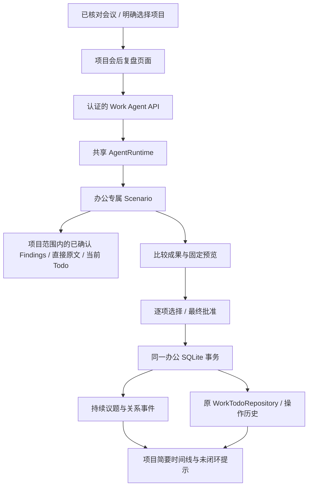
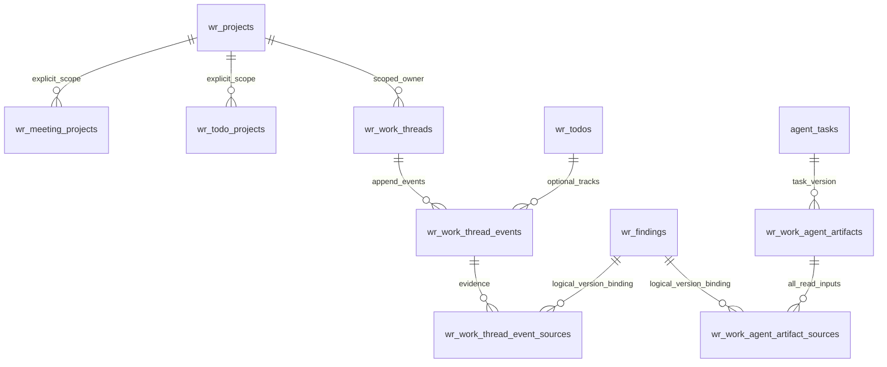

# Work Review Agent P1 实施报告

日期：2026-10-28（Asia/Shanghai）。本地 P1 产品闭环已实现并通过离线验收；真实 Provider 未验收。代码保持未提交，最终门禁结果见第 7 节。

## 1. 基线、工作区与边界

| 项目 | 实际状态 |
| --- | --- |
| 开发目录 | `C:\Users\50245\.codex\worktrees\work-review-agent-p1\daily-brief-source-20260708-122232` |
| 开发分支 | `codex/work-review-agent-p1` |
| 完整基线 SHA | `0653b3f18d56c121935f50502a0dedef06ba5bcd` |
| GitHub main | 经用户授权 `git fetch origin main` 核对，仍为上述 SHA；本地开发分支从该基线创建 |
| 原 Windows 工作区 | `C:\Codex\daily-brief-source-20260708-122232` 的旧 main 为 `dd3e1315f19ba428f61f6103ca38211446335c03`，原 dirty 内容保留 |
| 其他本地版本 | `codex/learning-release-20261027` 与最新 main 同 SHA；`dev/cloud-code` 为 `d77a691`，不能作为今天的最新集成基线 |
| 代码发布 | 未 commit、push、合并或部署；GitHub main 未被本次开发改变 |

读取了根 AGENTS、PRODUCT、DESIGN、验证说明和已完成的研究报告，并核对真实调用链。研究报告是旧基线快照，未据此重新实现 Agent 框架。本次仅修改办公产品及必要验证、文档；Learning 业务和共享 AgentRuntime 源码保持不变。

仅在隔离合成 SQLite 数据库运行迁移与测试。没有读取真实用户数据库、录音、私有配置或生产数据，没有访问服务器，也没有发起真实 DeepSeek、ASR、OCR 或其他付费 Provider 请求。依赖复用同基线本地工作区的 node_modules，没有新增生产依赖或全局功能开关。

## 2. 用户实际能做什么

1. 在整场会议完成核对后，从“所属项目”选择“与「项目名」历史对比”。多项目显示各自入口，由用户明确选择一个项目；未关联项目只提示先关联，未完成核对不显示入口。
2. 在项目页输入自然语言目标，例如“今天这场会和之前有什么变化？”或“帮我整理今天开完会之后的工作”。页面显示新增、变化、建议解决、未解决及待核实内容，并给出实际读取范围。
3. 打开每条结果的会议原文。引用每次通过服务端重新检查，展示已确认 Finding、直接关联的 canonical 段落、时间与时间戳质量。
4. 看到固定修改预览中的旧状态和新状态，逐项选取、全选或全部不采用，再进行一次明确的最终保存确认。未选中的建议不执行。
5. 从项目列表重新进入“会后比较与工作脉络”，查看保存的比较、批准结果、简要决策／问题时间线和未闭环提示。比较结果与修改建议关闭页面后仍可恢复。
6. 只要求比较时可以结束于已保存的比较结果，不强迫修改 Todo；稍后可以从原比较继续选择后续工作，复用已保存内容。
7. 暂停、继续、取消，检查原操作结果；结果未知时不自动重发。用户也可以明确撤回错误关联，保留撤回记录。

入口与页面：`src/components/work-review/work-meeting-detail.tsx:872`、`work-projects-page.tsx:238`、`work-agent-page.tsx:23`，路由为 `/work-review/projects/[projectId]?meeting=...`。用户看到的是项目名、会议原文和修改内容，不需要输入任何 ID。

本阶段未实现完整雷达、完整时间线独立页面、定时扫描或会前准备。未闭环提示仅依据当前 Todo 状态与已确认关系，不把缺少记录表述为现实中未完成。

## 3. 架构与复用



`agent-service.ts:15` 直接实例化原 `AgentStore` 与 `AgentRuntime`，复用任务状态、checkpoint、租约、操作回执、确认指纹、预算和 unknown 恢复。办公任务账本放在办公 SQLite 内，checkpoint 使用同目录 `work-agent-checkpoints.sqlite`。这让事务写入和任务授权检查共享同一数据库串行化边界，同时不读取 Learning 的业务数据。

业务工具与调用关系如下：

| 工具 | 实际职责与复用对象 |
| --- | --- |
| `work.read_project_context` | 显式项目内会议、已确认 Findings、有效直接原文和 Todo 当前状态；复用 WorkProjectRepository / WorkReviewRepository / WorkTodoRepository |
| `work.read_meeting_evidence` | 只允许本轮实际读取的 Finding，重新校验 canonical publication 与段落 |
| `work.compare_meeting` | 使用现有办公分析模型配置与传输适配器，通过 `ctx.call` 记账；持久保存比较，不写关系或 Todo |
| `work.preview_follow_up_changes` | 固定修改内容、旧新状态、来源指纹，进入共享 Runtime 的业务等待 |
| `work.apply_confirmed_changes` | 共享确认机制批准后，在办公事务内调用原 Todo 验证和事件逻辑；保存关系及应用回执，核对实际结果后结束 |

工具定义见 `agent-scenario.ts:13`，业务事件路由见 `agent-scenario.ts:73`。这里仅定义办公场景，没有新增任务循环或替换共享框架。办公完成判断看真实比较成果和应用回执，不采用 Learning 的掌握程度标准。

模型适配见 `agent-model.ts:18`。遵循既有办公 Provider profile，不引入新 Provider 路由。结构化响应严格校验，配置失败发生于请求前；传输未知保留 unknown，无隐式重试、无 Provider fallback。实际模型语义质量仍需后续获授权的真实验收，离线注入不能证明这一点。

## 4. 最小增量持久化

办公 schema 从 V9 升为 V10，新增 5 张产品专属表，定义见 `agent-schema.ts:2`，由现有 `schema.ts` 迁移链执行。

| 表 | 保存内容 | 权威边界 |
| --- | --- | --- |
| `wr_work_threads` | 账号、项目、持续议题身份、原始 anchor Finding ID | 不复制原会议结论 |
| `wr_work_thread_events` | records / suspends / supersedes / withdraws / resolves / reopens / tracks / retracts；两端 Finding、Todo、批准账号和时间、来源会议日期、稳定操作键 | 追加关系事件；不存第二份 current decision / closed 状态 |
| `wr_work_thread_event_sources` | 每条关系的项目、会议、Finding、来源指纹 | 关系必须有已确认原文依据；失效后禁止继续引用 |
| `wr_work_agent_artifacts` | 任务版本、比较内容、覆盖范围、固定预览、选择、实际应用结果与 action ID | Agent 成果和业务回执；不能替代 Todo 当前状态 |
| `wr_work_agent_artifact_sources` | 本轮实际读取的全部 Finding 来源绑定 | 包括“缺少后续记录”判断所用输入，来源失效时清理比较正文 |



图中 Finding / Todo / AgentTask 连线部分为服务端逻辑绑定，不全部是物理外键。项目和议题使用账号／项目复合约束；来源删除后保留不含正文的失效事件屏障，避免物理级联把历史变化完全抹去并错误恢复旧决定。

决定状态、问题状态由 `agent-context.ts:54` 的有效已确认事件投影。原 Todo 表仍是唯一 Todo 状态权威。原会议正文、Findings、Todo 来源字段及历史均不被关系操作覆盖。迁移不回填旧会议的已确认关系。

## 5. 确认、幂等、恢复与失效

### 固定预览与真实批准

- 比较输出经 schema、范围、角色、引用和日期检查。新 proposal 或暂定 decision 不能形成正式 supersedes；关闭问题不能只使用 proposal/discussion。
- 预览保存完整操作和旧新状态，指纹覆盖任务版本、上下文和操作。最终共享 approval 进一步绑定 task ID、工具、操作身份和来源指纹。
- 选择后不再让模型重新生成操作。用户拒绝后保留比较，结束本轮而不写业务关系或 Todo。
- 未提交时，任何相关 Todo、来源或项目范围变化都会使固定预览失效。需要重新比较和重新确认。

实现位置：`agent-repository.ts:65`、`:126`、`:172`，实际 API：`src/app/api/work-reviews/projects/[projectId]/agent/route.ts`。API 从认证账号取得 accountId，所有访问都核对项目及任务边界，返回 `private, no-store`。

### 同一事务与回执恢复

关系事件、Todo 更新／完成／创建，以及 artifact 的 applied 回执通过同一个办公数据库事务落地；复用原 TodoRepository 的验证、版本、操作键和历史写入。测试在批次后半部分注入失败，确认前面关系和 Todo 更新一起回滚。

Todo 操作键稳定绑定 artifact 和 change key；关系同时做有效关系去重。同一批准重放不会增加记录。撤回后的再次明确确认会新增事件，不修改原事件或抹去撤回历史。

如果办公事务已提交、Agent action receipt 写入失败，`recover` 按原 action ID 查到实际 applied 回执，核对 Todo 操作历史和当前业务结果，复用结果而不再生成或修改。相关实现位于 `agent-repository.ts:238`。原任务创建请求的同 ID 重放也能返回已完成任务，不因 Todo 已被本轮改变而另起操作。

### 来源失效与隐私清理

会议解除项目关联、Finding 删除／版本变化、canonical 删除、项目删除、关联 Todo 删除或解除项目关联，由触发器及读取时指纹校验共同处理。失效 artifact 清空 comparison、preview、coverage 正文；失效关系清空 label，只保留必要身份和应用回执。页面重新打开原文时再次校验，不继续展示失效引用。

**B 的依据失效或关系被撤回，不会自动恢复 A。** 投影保留不确定状态屏障，当前状态为待核实；后续新的明确确认可以建立新事实。撤回 tracks 等 Todo 联系不会凭空撤销仍有有效依据的正式决定。

账号／项目删除和取消后的晚到模型结果不能通过发布检查重新写入。共享框架本身的 budget、unknown、取消和租约规则未被放松。

## 6. 三场合成会议验收

沿用调研报告的“客户工单同步一期”案例，压缩成可离线复现的 14 条已确认 Finding。`agent-test-fixture.ts` 通过真实 repository 完成 canonical 发布、候选核对、整场核对和项目关联；不直接伪造已确认关系。

| 会议 | 合成事实 | 应有解释 |
| --- | --- | --- |
| M1，10-06 | 正式决定 A 实时直连；林晨部署；回滚重复写入和日志期限未解决；等待供应商配额；客户约束清单承诺 | A 正式；开放问题和待办各自存在；没有后续记录不等于没做 |
| M2，10-13 | 供应商配额 2 次/秒，需求峰值 20 次/秒；明确暂停 A；B 只是候选；赵宁承诺回滚测试 | A → 暂停，不能提前认定 B 已替代 A |
| M3，10-27 | 客户接受三分钟延迟，正式 B 替代 A；测试完成且回滚问题解决；原部署改 B、10-30；新增监控、10-29；日志和供应商仍待处理 | 提出关系与 Todo 修改，等待逐项批准 |

实际执行：先对 M2 的历史关联进行明确确认，再比较 M3。M3 生成 6 项建议，其中刻意注入“完成供应商等待”的错误建议，以验证用户拒绝门槛。选中其余 5 项并最终批准。

| 验收项 | 离线执行结果 |
| --- | --- |
| M2 不提前采用 B | PASS；proposal 替代 final 的操作被校验拒绝，时间线状态 suspended |
| A → 暂停 → B 替代 A | PASS；时间线保留各阶段及可打开原文 |
| 调整原部署 Todo | PASS；同一 ID，标题为 B 方案部署，期限 10-30，原来源 Finding 不变 |
| 完成测试 Todo | PASS；通过原 Todo 完成操作落地 |
| 关闭回滚问题 | PASS；独立 resolves 事件，不以 Todo 完成冒充问题关闭 |
| 新增监控 Todo | PASS；创建一次，期限 10-29；重复批准不增加记录 |
| 日志期限／供应商等待／客户约束 | PASS；保持开放或待核实，拒绝项没有写入 |
| 刷新与重新打开 | PASS；比较、预览、批准结果和关系可恢复；比较后也能继续保存 |
| 事务回执丢失 | PASS；注入提交后 action receipt 失败，恢复核对原业务结果，零重复 Todo 事件 |
| 来源删除／移出项目／版本变化 | PASS；清理比较正文和失效引用，B 失效不恢复 A |
| 跨账号、跨项目、未关联会议 | PASS；拒绝范围外启动和引用 |

浏览器验收使用真实页面、真实 SQLite 和 Runtime，HTTP/auth 在 Playwright 中连接合成 fixture；实际 Next route 则由独立 API 测试执行。二者不能描述为真实 Provider 或真实登录部署环境的联合验收。

截图：`output/playwright/work-agent-p1-desktop.png`、`work-agent-p1-mobile.png`。移动宽度 390px 无横向溢出。测试在页面最终确认后核对数据库，而非仅断言某个工具 mock 返回“成功”。

## 7. 验证记录

所有本轮最终命令在本报告工作区执行。离线入口 `output/work-agent-p1/offline-run.mjs` 是本次输出目录内的验证包装器：清除继承的业务配置，复用仓库已有离线网络 guard，仅允许 loopback，APP_DATA_DIR 指向合成输出目录。它不是产品运行入口，不进入产品功能或新增平台配置。

最终门禁状态：**本地离线通过**。全量后发现办公建议 key 允许过长，可能超过共享 Runtime 的 2,000 字符反馈上限；最终将 key 限为 64 位 ASCII，并在固定选择前校验反馈长度，补充批准后执行前取消的断言。另外对齐合成测试 Todo 的负责人／期限。随后运行办公定向复验、重新 production build 和生产构建上的浏览器验收；没有无理由重复全量。

| 实际验证 | 退出码 | 文件／用例数与结果 |
| --- | --- | --- |
| 全量离线 Vitest，558.83 秒 | 0 | 598 文件：596 PASS、2 SKIP；7,264 PASS、9 SKIP、0 FAIL |
| 全量后最终办公定向复验，41.24 秒 | 0 | 4 文件、24/24 PASS（repository/Runtime 17、API 2、页面 2、模型适配 3） |
| 相邻迁移修正最终复验 | 0 | project-deletion 1 文件、7/7 PASS；随后全量包含全部相邻模块 |
| 最终 `npm run lint` 包装执行 | 0 | Next typegen + 完整 TypeScript；最终小修后的 build 再次完成类型检查 |
| production build + postbuild | 0 | 最终编译通过，44/44 静态页面生成；182 份 trace 清理，removed=42、forbidden=0 |
| 最终生产构建 Browser E2E，9.4 秒 | 0 | 1 文件、1/1 PASS；真实组件＋合成 SQLite/Runtime，HTTP/auth fixture，真实 Provider 0 次 |
| 最终 `git diff --check` / `git status --short` | 0 / 0 | 无空白错误；本轮改动未提交，历史仅追加 12 行、删除 0 行 |

9 个跳过项来自原有 Learning 真实 PDF 验收：`paddle-handoff.integration.test.ts` 的 8 项需显式历史交接资料，`pdf-real-regression.test.ts` 的 1 项需原始 PDF。本轮未提供这些资料、未改跳过规则，也未用合成数据替代其验收。

可复现的实际命令如下（均在第 1 节工作区执行）：

```powershell
node output/work-agent-p1/offline-run.mjs test --reporter=default --reporter=json --outputFile=output/work-agent-p1/full.json
node output/work-agent-p1/offline-run.mjs test src/lib/server/work-review/agent-p1.test.ts src/lib/server/work-review/agent-model.test.ts src/app/api/work-reviews/work-agent-routes.test.ts src/components/work-review/work-agent-page.test.tsx --reporter=default --reporter=json --outputFile=output/work-agent-p1/focused-final.json
node output/work-agent-p1/offline-run.mjs test src/lib/server/work-review/project-deletion.test.ts --reporter=default --reporter=json --outputFile=output/work-agent-p1/migration-recheck.json
node output/work-agent-p1/offline-run.mjs lint
node output/work-agent-p1/offline-run.mjs build
node output/work-agent-p1/offline-run.mjs start
node output/work-agent-p1/offline-run.mjs e2e e2e/fixtures/work-agent-p1.spec.ts --project=chromium --workers=1 --reporter=list
git diff --check
git status --short
```

`start` 只供另一终端的浏览器验证访问 loopback；本轮验证结束已停止自有服务。产品正常启动仍沿用仓库原入口。输出目录未纳入 Git，离线包装器与 JSON/日志为本地验收证据；如迁移到另一工作区，应携带该包装器或依照仓库验证说明配置等价隔离环境。

关键原始证据：`output/work-agent-p1/full.json`、`focused-final.json`、`test-1793174120829.log`、`test-1793174833011.log`、`lint-1793174402540.log`、`build-1793174915417.log`、`e2e-1793175140919.log`。最终 24 项复验是在全量之后，不将新增的 1 项算作那轮全量已执行。

已经完成的定向证据：

- 原始四文件验收 23 项中 21 通过、2 项因默认 5 秒超时失败；均为多轮 SQLite/checkpoint 集成案例。保留原断言，给该集成 suite 显式 20 秒时限，单文件复验 **16/16 通过**。没有放松产品执行时间或预算。
- API 2 项、受影响新页面组件 2 项、离线模型适配 3 项均已通过。首次 sandbox 启动 Vitest 的 `spawn EPERM` 属于配置加载失败，未执行任何测试；之后正常环境执行。
- 相邻第一轮：4 文件、63 通过／1 失败，原因是旧 Todo schema 断言仍要求 V9；同步 V10 后，进一步发现 V8 降级 fixture 未移除新触发器。修正 fixture 的旧 schema 重建步骤；独立迁移／项目删除文件 **7/7 通过**，不删除业务断言。
- 浏览器第一轮 **1/1 通过**（31.7 秒），加入“旧状态已暂停”断言后复验 **1/1 通过**（16.2 秒）。桌面／手机截图、页面异常和外部网络检查通过。
- `npm run lint`（包含 Next typegen 和完整 TypeScript）已经通过一次；最终新增 E2E 后再核对一次。

早期直接执行的命令：`npm test -- src/lib/server/work-review/agent-p1.test.ts`（先配置加载失败、随后 1 文件 4 FAIL、修复后 4 PASS）；`npm test -- src/lib/server/work-review/agent-p1.test.ts src/app/api/work-reviews/work-agent-routes.test.ts src/components/work-review/work-agent-page.test.tsx`（先 3 文件 8 PASS，扩展后 17 PASS／1 FAIL，该失败是拒绝确认预期仍写作 paused）。这些版本的计数属于各自开发时点，不与最终用例数累加。

相邻两次失败命令分别为 `node output/work-agent-p1/offline-run.mjs test src/components/work-review/work-meeting-detail.test.tsx src/components/work-review/work-projects.test.tsx src/lib/server/work-review/project-repository.test.ts src/lib/server/work-review/todo-repository.test.ts --reporter=default --reporter=json --outputFile=output/work-agent-p1/adjacent.json`（退出 1，4 文件 63 PASS／1 FAIL）及 `node output/work-agent-p1/offline-run.mjs test src/lib/server/work-review/todo-repository.test.ts src/lib/server/work-review/project-deletion.test.ts src/components/work-review/work-meeting-detail.test.tsx --reporter=default --reporter=json --outputFile=output/work-agent-p1/adjacent-recheck.json`（退出 1，3 文件 52 PASS／1 FAIL）。修正范围仅为 V10 版本断言、V8 fixture 重建和组件异步测试等待，业务安全断言保留。

早期开发失败也已保留：合成 fixture 缺少 `markAnalysisVerifying` 导致 canonical digest mismatch，修正测试发布流程后通过；拒绝确认的测试最初仍期望 paused，办公场景现在明确结束该被拒绝的修改轮次，修正为 ended 并验证零写入。这些失败未被描述为产品通过。

真实 DeepSeek／ASR／OCR、付费 Provider、服务器及生产验证：**NOT RUN（本轮明确禁止）**。

## 8. 变更范围

新增产品文件：`src/lib/domain/work-agent.ts`；办公服务目录中的 `agent-schema.ts`、`agent-context.ts`、`agent-repository.ts`、`agent-model.ts`、`agent-scenario.ts`、`agent-service.ts`；项目 agent API；项目详情页面；`work-agent-page.tsx` 及其模块样式。

调整产品文件：办公 `schema.ts`，会议详情和项目列表的入口。未更改原 Todo 服务、会议审核业务、Learning Agent、共享 AgentRuntime、Provider 凭据配置或生产依赖。

验证与文档：三场会议 fixture、新增 repository/Runtime、API、model adapter、页面测试和浏览器 fixture；会议入口测试、Todo schema 版本测试、项目删除迁移 fixture；本报告与根 `UPDATE_HISTORY.md` 追加记录。

## 9. 已知限制与后续验证

- 模型真实语义准确性未签署。P1 是有来源的建议和人工批准流程，仍需要用户核对错误关联；没有把用户批准替代原会议事实。
- 模型上下文最多取当前及此前 8 场显式关联会议、60 条 Findings／约 18,000 字符来源；Todo 最多 40 条／12,000 字符状态字段；持续议题最多 20 个、每个最近 6 条关系／4,000 字符。超出、无效或未读范围明确显示。共享 Runtime 还会校验最终请求字符上限，超限即停止，不声称完成全历史扫描。
- 这是最小时间线和未闭环提示，尚无语义搜索、完整议题编辑、完整雷达评分、定时提醒或会前准备。项目成果列表沿用共享 Store 最近 50 个任务上限；大量历史的分页和检索需要后续有实际需求再设计。
- 同日会议不据日期推定先后。关联仍需明确批准；事件按会议日期和确认插入顺序呈现，不声称推断了精确会议时序。
- 来源保护采用保守失效策略：读取范围中的相关版本变化会要求重新比较，可能比仅比较被选中操作更严格。
- 目前不能直接编辑已经固定的建议；可以拒绝，再重开比较，或通过现有 Todo 页面进行用户自己的修改。事务中的某项失败不会只提交其余项。
- 模型超时或结果未知时，原结果检查找不到已保存成果就继续保留未知；不会自动重新调用模型猜测结果。
- V10 在既有办公数据库打开时迁移。本轮仅验证合成 V8/V9→V10，没有触碰实际工作数据库。回退到旧 V9 程序前需要明确的数据回退方案，不能直接覆盖已迁移的数据。

后续 Windows 真实验收须在另行授权后进行：备份被指定的本地测试数据库；确认代码基线与本轮 diff；使用明确指定的办公 Provider 和调用预算；用这三场合成会议测试自然语言目标、比较准确性、固定批准、断网恢复、删除来源；再记录真实调用数、响应状态、成本及未满足项。若授权服务器或生产操作，必须另行指明目标环境。本报告不产生此类授权。

## 执行摘要

现有会议、Findings、项目、Todo 和 AgentRuntime 已组合成一个可回看的 P1 会后复盘闭环。新增的是跨会议持续议题、确认关系与固定成果／回执；需要办公数据库 V10 的 5 张增量表。Todo 当前状态继续由原 Todo 系统维护，决定和问题状态由确认事件推导。

最小时间线、未闭环提示和会后比较读取同一套项目事实。当前优先交付的用户目标是：完成会议核对后比较项目历史，选取并保存后续工作，刷新回来仍能继续。后续真实 Provider 验收未运行，未自动进入 P2/P3，也未提交或发布代码。
